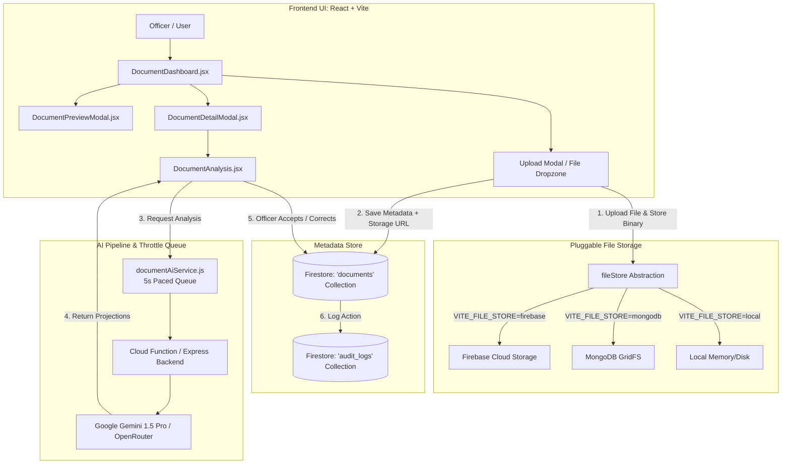

# Document Management System: Feature Summary & Complete Walkthrough
**Supreme Student Government (SSG) Operations — Assistant Application**

---

## 1. Executive Summary

The **Document Management System** in this platform serves as the central institutional repository and intelligence layer for the Supreme Student Government (SSG). It manages the entire lifecycle of student government records—including official memoranda, resolutions, executive orders, session minutes, committee reports, financial vouchers, and student petitions.

Designed to eliminate misplaced paperwork and reduce manual filing overhead, the system incorporates:
1. **Decoupled Architecture**: High-capacity binary storage (Firebase Storage or MongoDB GridFS) decoupled from searchable metadata (Firestore).
2. **AI-Assisted Analysis ("Human-in-the-Loop")**: Automated extraction of document headers, reference numbers, agendas, executive summaries, and signatories using Google Gemini / OpenRouter, where **the AI proposes and the officer disposes**.
3. **Institutional Workflow**: Transparent tracking from drafting (`pending`) through review (`under_review`) to final approval (`approved`), coupled with an immutable audit log.

---

## 2. System Architecture & Data Flow



---

## 3. Core Features Breakdown

### 3.1 Ingestion & File Handling
* **Multi-Format Support**: Native handling for PDF documents (`.pdf`), Microsoft Word documents (`.docx`, `.doc`), plain text (`.txt`), and scanned image proofs (`.png`, `.jpg`, `.jpeg`).
* **Strict Validation**: Enforces a 25MB file size ceiling (`MAX_FILE_SIZE_BYTES = 25 * 1024 * 1024`) and verifies MIME types before network transmission to prevent malicious file uploads.
* **Storage Independence**: The UI talks to a unified storage adapter ([fileStore/index.js](file:///c:/Users/User/Desktop/REACT PROJECTS/React js BootCamp/Shirio/src/services/fileStore/index.js)). Developers can toggle between Google Firebase Cloud Storage, self-hosted MongoDB GridFS, or local dev storage without touching UI components.

### 3.2 Search, Filtering & Categorization
* **Real-Time Text Search**: Substring matches against document title, subject, reference number, and executive summary.
* **Multi-Filter Bar**:
  * **Status Filter**: `All`, `Pending`, `Under Review`, `Approved`.
  * **Category Filter**: `All Categories`, `Resolutions`, `Memoranda`, `Executive Orders`, `Minutes of the Meeting`, `Letters / Communications`, `Financial Documents`, `Committee Reports`, `Petitions`.
* **Dynamic Badge Identifiers**: Color-coded badges indicating current workflow stage and AI processing state (`not_processed`, `processing`, `suggested`, `verified`, `corrected`, `failed`).

### 3.3 High-Fidelity Inline Preview
* **No External App Required**: Officers can view files directly inside [DocumentPreviewModal.jsx](file:///c:/Users/User/Desktop/REACT PROJECTS/React js BootCamp/Shirio/src/components/Document/DocumentPreviewModal.jsx) with responsive zoom controls and full-screen toggling.
* **Format-Specific Rendering**:
  * **PDFs**: Rendered inside an interactive PDF iframe viewer with direct download fallbacks.
  * **Images**: Centered, high-resolution preview with zoom/pan support.
  * **Text/Docs**: Text previewer and direct streaming download button.

### 3.4 AI-Assisted Document Analysis (Human-in-the-Loop)
Located in [DocumentAnalysis.jsx](file:///c:/Users/User/Desktop/REACT PROJECTS/React js BootCamp/Shirio/src/components/Document/DocumentAnalysis.jsx) and backed by [documentAiService.js](file:///c:/Users/User/Desktop/REACT PROJECTS/React js BootCamp/Shirio/src/services/documentAiService.js):
* **6-Stage Extraction Pipeline**:
  1. **Document Classification**: Detects document type (Resolution, Memorandum, Minutes, etc.).
  2. **Institutional Numbering**: Extracts reference numbers (e.g., `SSG-RES-2026-004`).
  3. **Agenda & Subject**: Summarizes core intents and background subjects.
  4. **Executive Summary**: Generates a 2-3 sentence executive summary for quick briefings.
  5. **Signatory Detection**: Identifies names, official designations, and expected signatories.
  6. **Tagging & Keywords**: Suggests relevant thematic tags.
* **Paced Queue & Rate Limiting**: Features a built-in 5000ms throttled task queue to respect free/standard tier Gemini API limits (15 RPM) and prevent `429 Too Many Requests`.
* **Human Verification Principle**:
  * The AI **never** overrides official document metadata without human sign-off.
  * Projections are staged in a draft comparison table.
  * Officers can click **"Accept All"**, selectively pick individual fields, or **"Edit & Correct"**. Corrections are tagged with an audit trail note explaining what was altered.

### 3.5 Signatory & Approval Tracking
* Each document tracks required signatories extracted from the document body.
* Officers can check off signers as physical or electronic signatures are secured, updating the document toward `Approved` status.

### 3.6 Audit Trail & Accountability
* Every upload, AI execution, manual metadata change, status advancement, and document deletion is logged via [auditService.js](file:///c:/Users/User/Desktop/REACT PROJECTS/React js BootCamp/Shirio/src/services/auditService.js) recording the actor's UID, timestamp, action type, and before/after state diff.

---

## 4. End-to-End Walkthrough Guide for Officers

### Step 1: Accessing the Document Dashboard
1. Log into the SSG Assistant application.
2. Navigate to **Document Management** via the primary sidebar or header navigation.
3. The dashboard displays the document count metrics, filter pills, search bar, and the central document repository table.

---

### Step 2: Uploading a New Administrative Record
1. Click the **"Upload Document"** button at the top right of the dashboard.
2. Drag and drop your file into the upload zone or click to select a file from your device (`.pdf`, `.docx`, `.png`, etc.).
3. Fill in the preliminary fields:
   * **Title**: e.g., *"Resolution Authorizing Campus Youth Leadership Summit 2026"*
   * **Document Type**: Select from the predefined list (e.g., *Resolution*).
   * **Reference Number**: Optional at this step (can be filled by AI later).
   * **Tags**: Add initial keywords (e.g., `Leadership`, `Budget`, `Campus Life`).
4. Click **"Save Document"**. The system stores the binary file in the configured cloud store and creates the metadata record in Firestore.

---

### Step 3: Running AI Document Intelligence
1. Click on the uploaded document row in the table to open [DocumentDetailModal.jsx](file:///c:/Users/User/Desktop/REACT PROJECTS/React js BootCamp/Shirio/src/components/Document/DocumentDetailModal.jsx).
2. Navigate to the **"AI Intelligence"** tab.
3. Click **"Analyze with AI"**:
   * The status badge changes to `Processing...` (queued).
   * The background AI service reads the document content.
4. When complete, a side-by-side comparison appears showing:
   * Current manual values vs. AI-suggested values.
   * Confidence level and detected summary.
   * Extracted list of signatories (e.g., *SSG President*, *Committee Chairperson*, *Adviser*).

---

### Step 4: Verification or Manual Correction
1. **Review Suggestions**:
   * If all suggested fields (Title, Agenda, Signatories, Ref #) match the document, click **"Accept Suggestions"**.
   * If any field needs fine-tuning (e.g., a typo in an officer's middle initial), edit the field directly.
2. Click **"Save & Verify"**.
3. The document status updates to **Verified** (or **Corrected** if altered), guaranteeing clean, canonical data in the institutional records.

---

### Step 5: Updating Workflow Status & Signatories
1. As the document moves through official channels:
   * Check off signatories in the **Signatories Checklist** as their approvals are submitted.
   * Change status from `Pending` to `Under Review` while under legislative or executive reading.
   * Change to `Approved` once all required signatures and seal are affixed.
2. The document is now officially cataloged and indexed for instant retrieval by future student council administrations.

---

## 5. Technical Reference & Key Source Files

| Area | File Path | Primary Responsibility |
| :--- | :--- | :--- |
| **Main Dashboard** | [src/components/Document/DocumentDashboard.jsx](file:///c:/Users/User/Desktop/REACT PROJECTS/React js BootCamp/Shirio/src/components/Document/DocumentDashboard.jsx) | Upload modal, table view, search, category filters, and action triggers. |
| **AI Extraction UI** | [src/components/Document/DocumentAnalysis.jsx](file:///c:/Users/User/Desktop/REACT PROJECTS/React js BootCamp/Shirio/src/components/Document/DocumentAnalysis.jsx) | 6-stage suggestion display, accept/correct diff view, quota indicator. |
| **Detail Inspector** | [src/components/Document/DocumentDetailModal.jsx](file:///c:/Users/User/Desktop/REACT PROJECTS/React js BootCamp/Shirio/src/components/Document/DocumentDetailModal.jsx) | Metadata editing, workflow status selector, signatory checklists. |
| **Preview Viewer** | [src/components/Document/DocumentPreviewModal.jsx](file:///c:/Users/User/Desktop/REACT PROJECTS/React js BootCamp/Shirio/src/components/Document/DocumentPreviewModal.jsx) | Responsive modal for inline rendering of PDFs, images, and text files. |
| **Status Badge** | [src/components/Document/AiStatusBadge.jsx](file:///c:/Users/User/Desktop/REACT PROJECTS/React js BootCamp/Shirio/src/components/Document/AiStatusBadge.jsx) | Visual indicator for `not_processed`, `suggested`, `verified`, etc. |
| **Data Service** | [src/services/documentService.js](file:///c:/Users/User/Desktop/REACT PROJECTS/React js BootCamp/Shirio/src/services/documentService.js) | Firestore CRUD, querying, search indexing, and 25MB validation. |
| **AI Service** | [src/services/documentAiService.js](file:///c:/Users/User/Desktop/REACT PROJECTS/React js BootCamp/Shirio/src/services/documentAiService.js) | Gemini/OpenRouter queue, 5s pacing throttle, quota management. |
| **Storage Adapter** | [src/services/fileStore/index.js](file:///c:/Users/User/Desktop/REACT PROJECTS/React js BootCamp/Shirio/src/services/fileStore/index.js) | Factory router for Firebase, MongoDB GridFS, and Local storage. |
| **Taxonomy & Schema**| [src/utils/documentLabels.js](file:///c:/Users/User/Desktop/REACT PROJECTS/React js BootCamp/Shirio/src/utils/documentLabels.js) | Seed categories, status enums, and allowed file formats. |

---

## 6. Environment Configurations

To configure storage and AI backend providers, check `.env`:

```env
# Storage Provider: 'firebase' | 'mongodb' | 'local'
VITE_FILE_STORE=firebase

# AI Execution Provider
VITE_AI_PROVIDER=gemini
# Optional: OpenRouter fallback
# VITE_AI_PROVIDER=openrouter
# VITE_OPENROUTER_API_KEY=your_key_here
```
